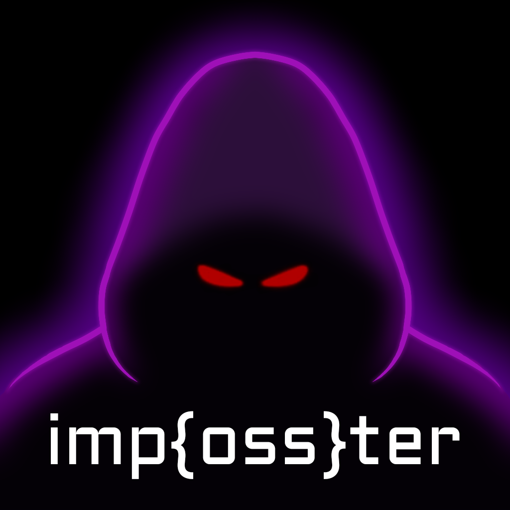

<h1 align="center">imp{oss}ter</h1>

 
This is a SolidJS-built implementation of the popular party game "Imposter". I play this every day at school with my friends, but after a year and a half of playing, we have started to recognize the hint words and there are a lot of repetitions. You can buy more words, more categories, and more settings with a premium plan, but why do that when I can just build my own OSS version? I've never built anything myself with a reactive webapp language (react, solid, etc), so this was a huge learning opportunity for me. No, nothing was made with AI*. Every line, npm install, git commit, css style, TS function, and the logo art was written and created completely by me.
 
<i>*The only exceptions to this statement are: I used it extremely lightly at the start to ask questions about SolidJS (if the docs weren't clear). However, towards the end I shifted entirely to stack overflow, a more thorough reading of the docs, and manual trial-and-error. The only other way AI was used was to give me ~1000 words, but NOT the hint words. It gave me a list of 1000 words that fit the categories I chose, and I made hint words for every single one of them.</i> Well, I am working on that anyways.
 
<b>The goal is 10k words by the end of 2026.</b>
  
keep creating, godspeed ♥️
